# Race Telemetry

Real-time sim-racing telemetry dashboard and race engineer's toolbox. A game, a real F1 race or a
recorded file feeds a small Node.js relay; the relay turns every source into one frame format and
streams it over WebSocket to a React dashboard. The dashboard charts 60 Hz telemetry with ECharts
without re-rendering React at 60 Hz, records every lap on a distance grid and turns the laps into
analysis: delta to the best lap, ghost lap, corner-by-corner comparison, trail braking, tyre
degradation, pit window, setup advice and a post-session debrief. The UI speaks English and Ukrainian.

```
Gran Turismo 7 (PS5, UDP + Salsa20) ──┐
OpenF1 historical F1 races ───────────┤
Demo race (simulated GT3 race) ───────┤
Uploaded raw data (CSV, recorder) ────┼──► relay (Node.js) ──WebSocket──► dashboard (React + ECharts)
Relay recordings (replay) ────────────┘        │                              │
                                               └── data/sessions/*.ndjson.gz  └── laps in IndexedDB
```

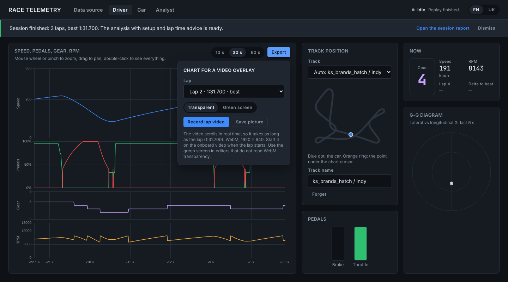

A detailed description of the project in Ukrainian, with the physics and maths behind every metric,
is in [docs/race-telemetry-uk.pdf](docs/race-telemetry-uk.pdf).

## Data sources

| Source | Where the data comes from | What you get |
| --- | --- | --- |
| **Gran Turismo 7** | PS5/PS4 in the same LAN. The relay sends a heartbeat to UDP 33739 and decrypts the Salsa20 packets arriving on 33740 (~60 Hz). | Speed, RPM, gear, pedals, steering, position, wheel speeds, suspension travel, tyre temps (one per tyre), water/oil temps, fuel, laps. G-forces and lap distance are derived. |
| **Formula 1, real races** | [OpenF1](https://openf1.org) historical API (free, no key). One driver's race is downloaded once, cached in `data/f1/cache`, and replayed as if live. | Speed, RPM, gear, throttle, brake on/off, position on track, laps with sectors, tyre compounds, weather, the whole field with gaps. |
| **Demo race** | Built-in race simulation: a GT3 sprint (10/20/30 laps) on a fictional 3.8 km circuit, nine rivals on their own pit strategies, weather that changes, a chequered flag. Plays at up to ×64, so a 20-lap race takes about half a minute. | Every channel, with the shapes and trends of real driving (see [Demo race](#demo-race)). Works anywhere. |
| **Upload race data** | Raw files on the **Upload data** page: CSV/TSV logs (raw GT7 60 Hz loggers, MoTeC, SimHub, Second Monitor exports), the telemetry recorder's `session.json` + `frames.bin` (GT7, Assetto Corsa), or a relay recording (`.ndjson.gz`). | Every channel in the file: laps with sectors, pit stops, track map, ghost lap, the full debrief. |
| **Replay** | Sessions the relay recorded (live GT7, demo, imported files). | Whatever the original source had. |

Each source announces its capabilities, so panels a source cannot fill are hidden or say so.
Live Assetto Corsa / ACC is not supported: on PS5 they expose no telemetry (on PC they use Windows
shared memory, which could be added later as another source). Their recorded files can be opened.

## Pages

Pages are cut by who reads them, and each page stacks its sections instead of hiding them in tabs.

### Driver

Speed, pedals, gear and RPM traces (10/30/60 s window, mouse-wheel zoom and pan), live readout with
the delta to the best lap, pedal bars, G-G diagram (last 6 s) and a mini track map with the car on
it. Replays and the demo race play at up to ×64, F1 races up to ×16.

**Video overlay export:** any recorded lap can be exported as a real-time WebM (VP9 with alpha,
1920 × 640, or on a green screen) or as a PNG, to lay over the onboard video of that lap.

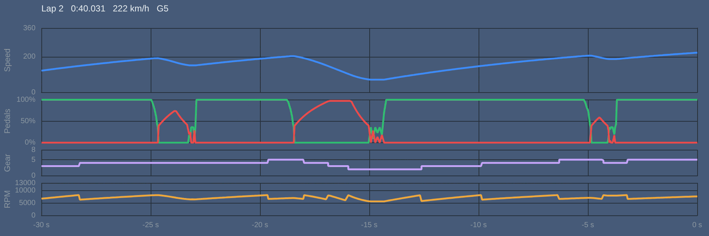

### Car

- **Condition now:** tyre temperatures against the window of the car class (GT3 / F1 / Road),
  brake temps, fuel, engine, wheel slip (locking / wheelspin) and ride height per wheel.
- **Tyre wear:** fuel-corrected degradation per lap tracked by a Kalman filter over the stint: laps
  in traffic are dropped as outliers, a rising rate is flagged as the tyres falling off, and the
  forecast band widens the further it looks. Plus laps left before the tyres leave their
  temperature or wear window.
- **Setup advice:** balance by corner phase (entry / mid / exit) from steering against the curvature
  the car follows, front/rear locking, wheelspin, bottoming and tyre balance, each turned into one
  setup change to try, with alternatives and a confidence level. An understeer gradient (°/G) fitted
  with the bicycle model, separately for slow and fast corners, tells mechanical balance from aero
  balance and gives the characteristic or critical speed.
- **Setup sheet:** GT7-style setup per car and track, stored in the browser; advice then gives exact
  values (e.g. "ARB rear 5 → 4").

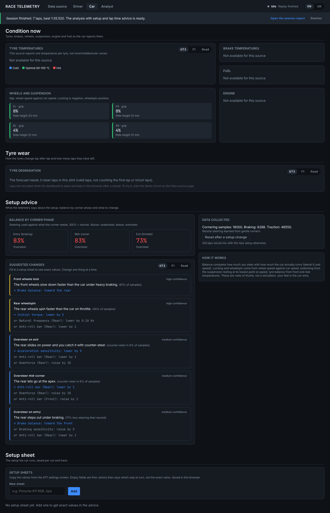

### Analyst

- **Session debrief:** best, ideal and theoretical lap, average and spread, lap-time chart, corners
  table (where the best lap lost time to your own fastest version of each corner), pedal shares
  (full throttle, braking, coasting, overlap), driving findings and a ranked "how to go faster" list.
  A banner offers the report as soon as a session ends.
- **Lap by lap:** per-lap numbers (top/min/avg speed, gear changes, max and average cornering G,
  fuel used, tyre temps) and a corner × lap matrix of time lost.
- **Braking and trail braking:** for every braked corner of the best lap: where the brake comes off
  against the apex, how much of the braking is done while turning, how fast the pedal is released,
  and how the lap that drove that corner fastest did it.
- **Lap against lap:** ghost lap overlay by distance with a delta trace and a corner-by-corner insight
  table, plus a track map coloured by where time is gained or lost.
- **Timing:** laps, sectors and the field with gaps.
- **Race strategy:** pit window (where you rejoin after a stop, clear air or traffic), the undercut
  against the car ahead with the chance it works, a Monte Carlo simulation of the rest of the race
  that picks the best lap to stop (with safety cars), and weather: OpenF1 readings, demo weather, or manual input for GT7, with the
  track temperature trend and what it means for tyres.

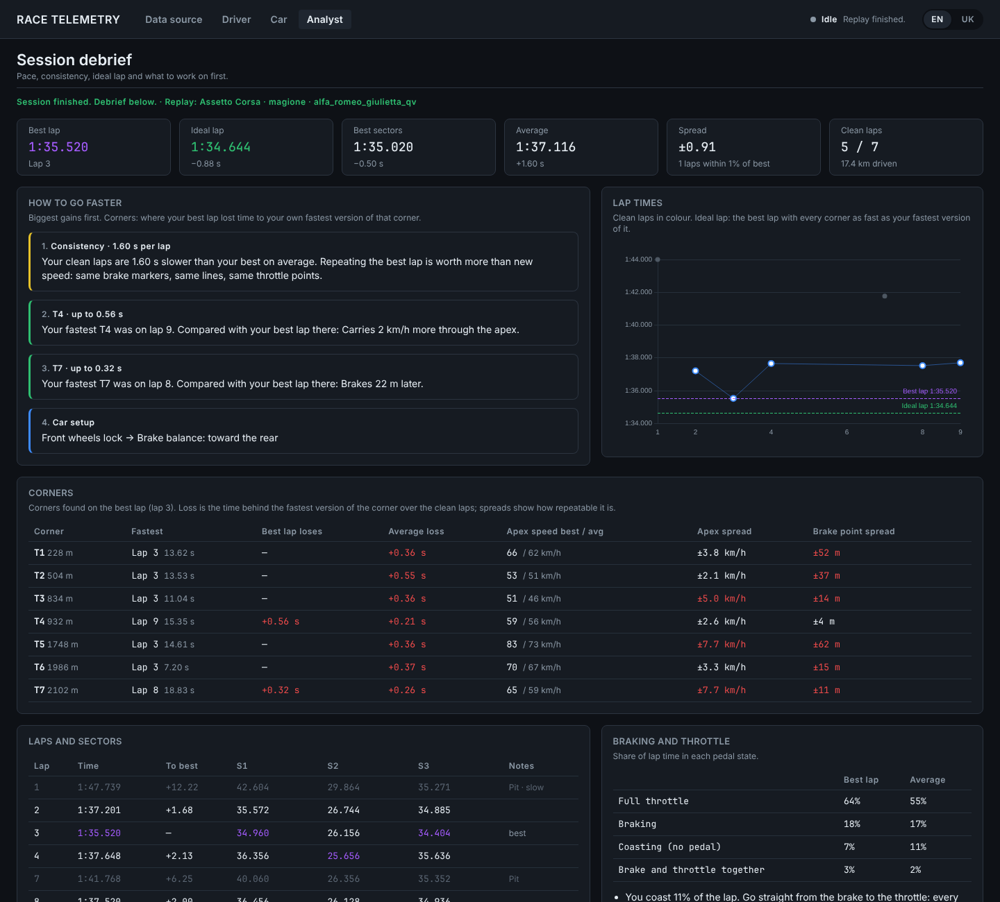

| Lap against lap | Trail braking |
| --- | --- |
| 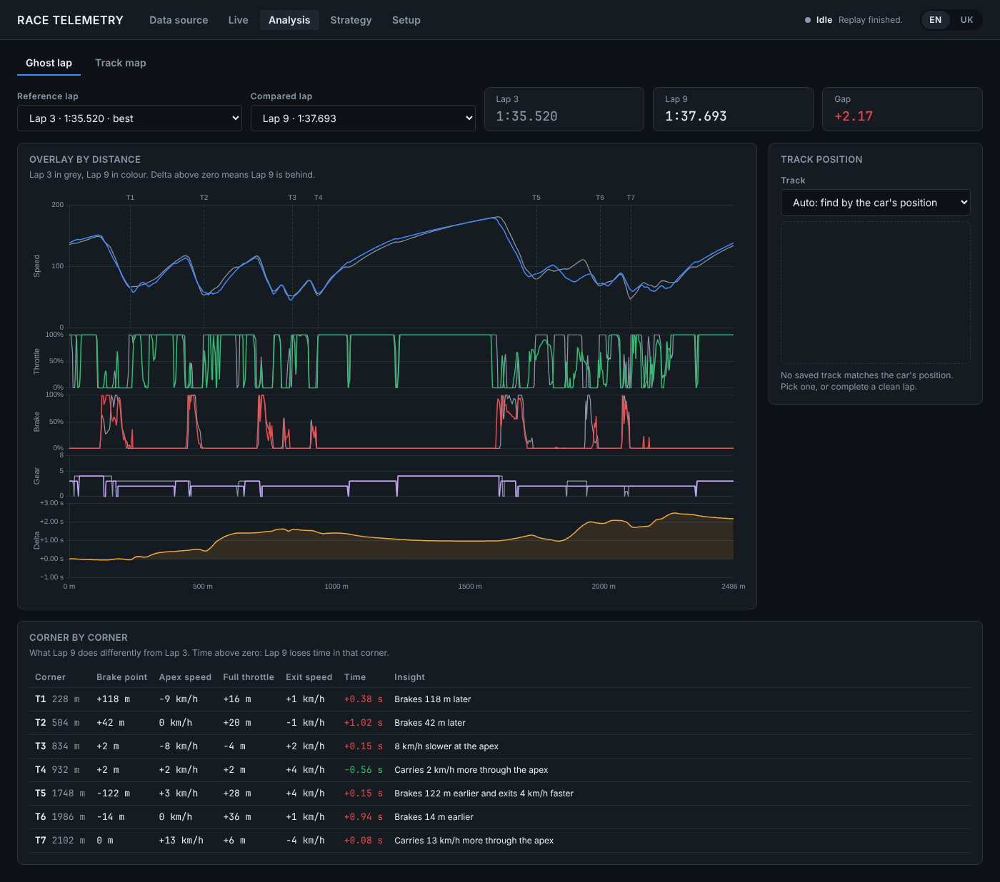 | 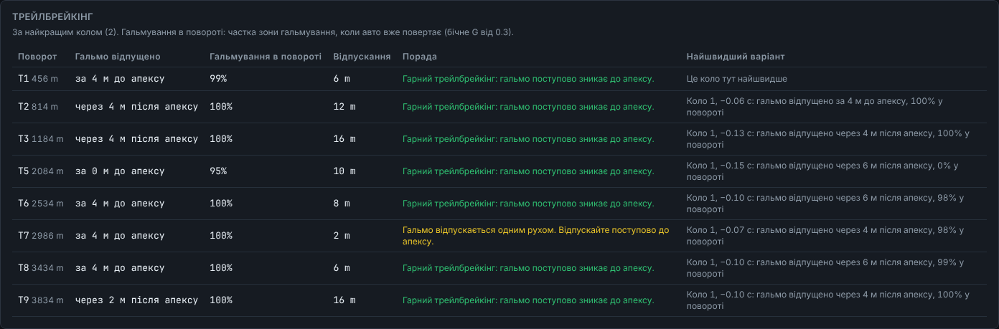 |
| **Track map** | **Pit window** |
| 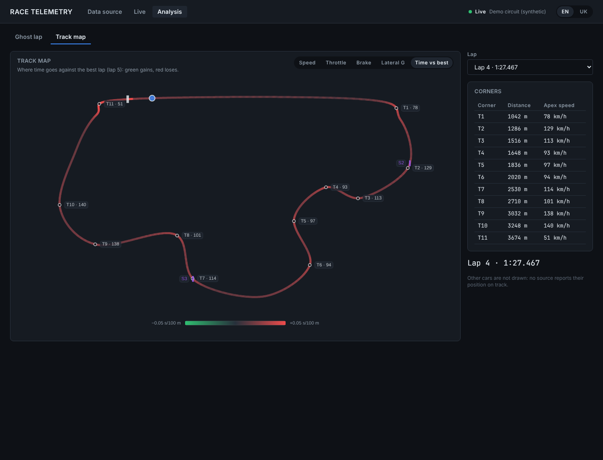 | 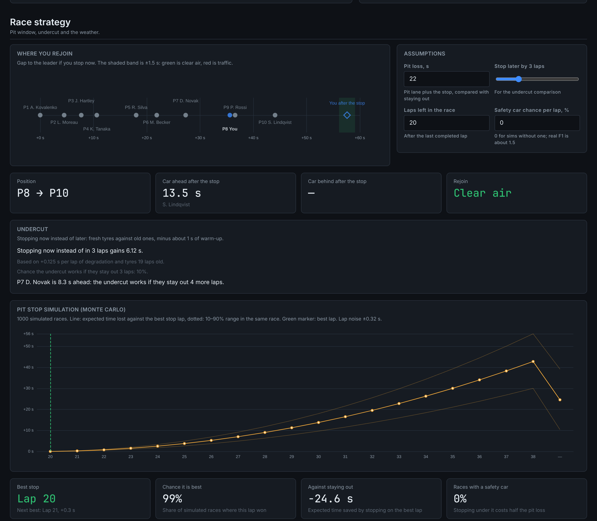 |
| **Tyre degradation** | **Weather** |
| 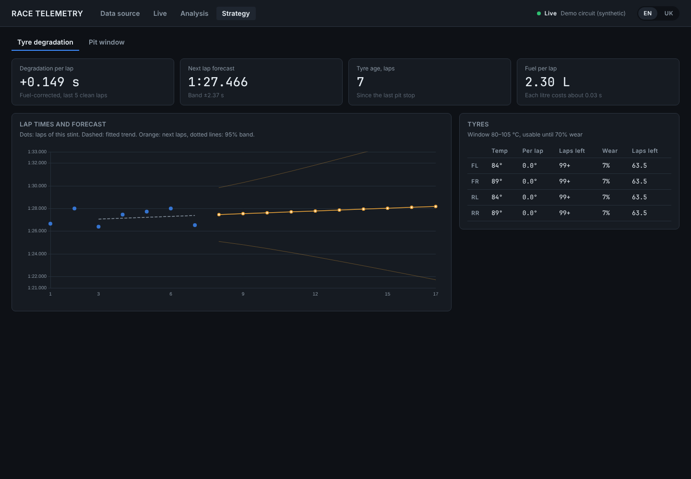 | 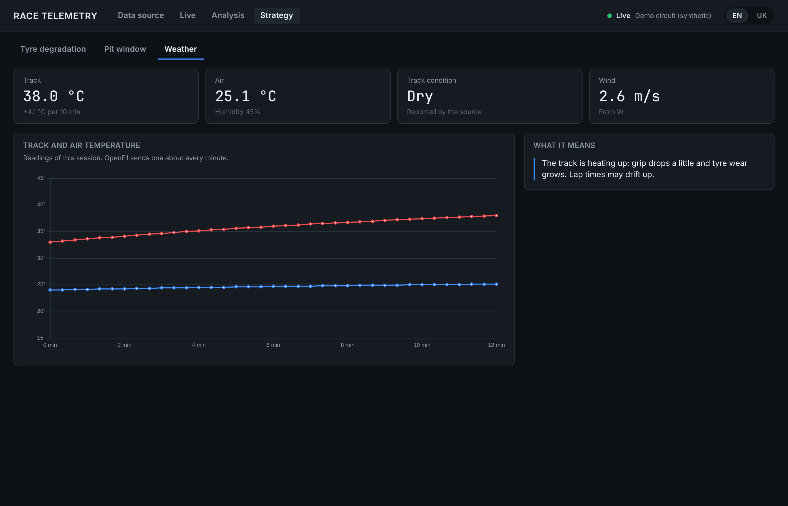 |
| **Understeer gradient and setup advice** | |
| 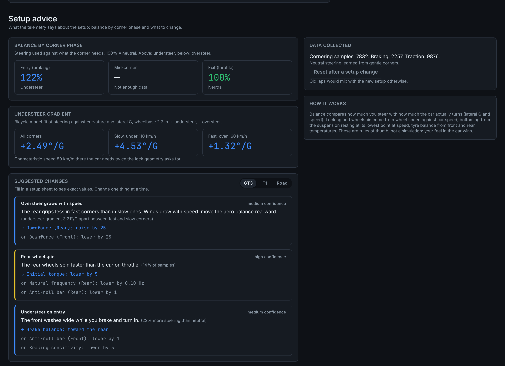 | |

### Data source

Pick a source, start and stop it, pick a replay. The playback speed of every non-live source is
changed on the Driver page.

### Upload data

A page of its own for raw race data. Drop the files (or click to choose); the page shows what each
file looks like, uploads with a progress bar and then reports what the relay found: valid laps, best
lap, pit laps, track length, samples, and which channels the file has, each with what it fills on the
dashboards (hover a channel). **Watch on the Driver page** replays it at the chosen speed, **Open the
analysis** plays it at ×64 straight into the Analyst page. Earlier uploads are listed and open again
without uploading twice.

How raw logs are read:

- **CSV / TSV** with a header row; metadata lines above it (`Venue,Magione`), a units row under it and
  units in brackets (`Speed [km/h]`) are understood, and so is gzip. Column names are matched by
  aliases (`t_s`/`time`, `speed_ms`/`speed`, `x`/`z` or `x`/`y`, `last_lap_ms`, `tyre_fl`,
  `wheel_fl`…), units by name or size: pedals as 0–1, % or 0–255 bytes, yaw rate in °/s or rad/s.
- **Laps** come from the lap counter, the lap position, or, without one, from where the car crosses
  the line: a log that starts and ends on the line keeps its first and last laps, and a single closed
  lap logged with the counter at 0 (a teammate's best lap) counts as lap 1.
- **Pit stops**: fuel going up or the car standing still for 8 s marks a pit lap.
- **Packet loss**: a gap where the car moved as far as its speed says is bridged, not treated as a reset.
- **Lateral G** without a G channel comes from speed × yaw rate, else from the change of heading.

For example the course file `race_gt7.csv` (12-lap GT7 race at 60 Hz) reads as 12 laps, best 1:26.005,
laps 6–7 marked as the pit stop, track 3.87 km.

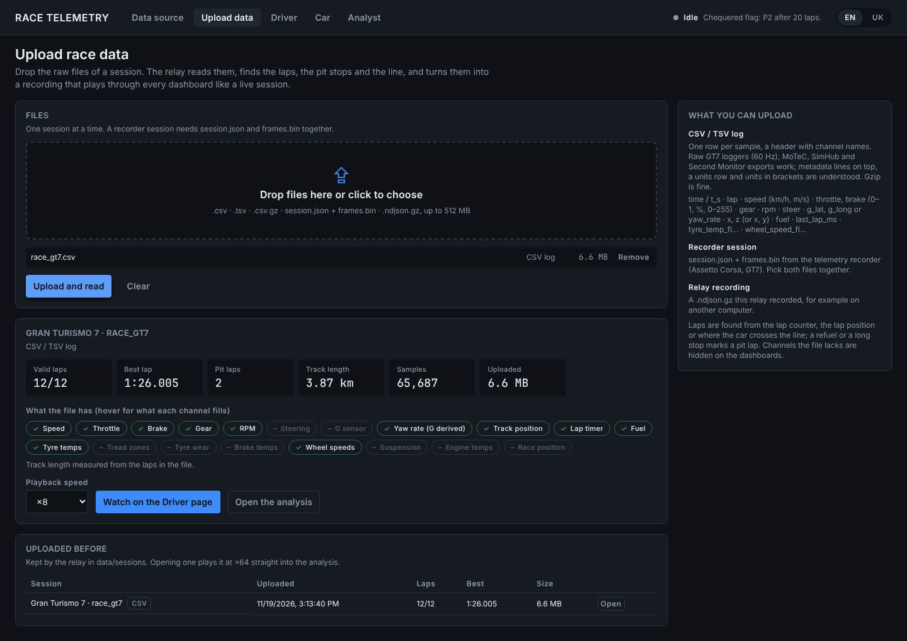

## Demo race

The demo is a small race simulation rather than a scripted loop, so every page has data that behaves
like real driving:

- **Car:** a point mass with a friction circle, downforce (+40% grip at 270 km/h), drag and a 290 W/kg
  power curve. Each lap's speed profile comes from the corner limit, a forward pass for traction and
  a backward pass for braking, so the traces show trail braking into the apex, progressive throttle
  on exit and a gear/RPM sawtooth from a six-speed gearbox.
- **Driver:** consistent habits a coach would spot (one corner braked early, one taken too slowly, one
  where pace comes and goes), lap-to-lap noise, a slow first lap, and occasional mistakes: lock-ups,
  running wide, a trip over the kerbs that invalidates the lap.
- **Tyres and fuel:** tyres warm up from 48 °C, heat with load and slip, wear faster when overheated
  and lose grip with wear and temperature, so lap times fade and temperatures creep up over a stint;
  fuel burns ~2.7 L a lap and its weight costs about 0.03 s per litre. Brakes heat to 550–650 °C at the
  front; suspension shows aero squat, pitch, roll, bumps and kerbs.
- **Race:** one pit stop at half distance (24 s in the box, 60 km/h pit lane) from mediums to softs,
  nine rivals with their own pace, compounds, degradation and stop laps, standing start, positions and
  gaps, and a chequered flag that ends the session and opens the session report.
- **Weather:** the sun heats the track for a quarter of an hour, then clouds cool it by several
  degrees while humidity and wind rise.

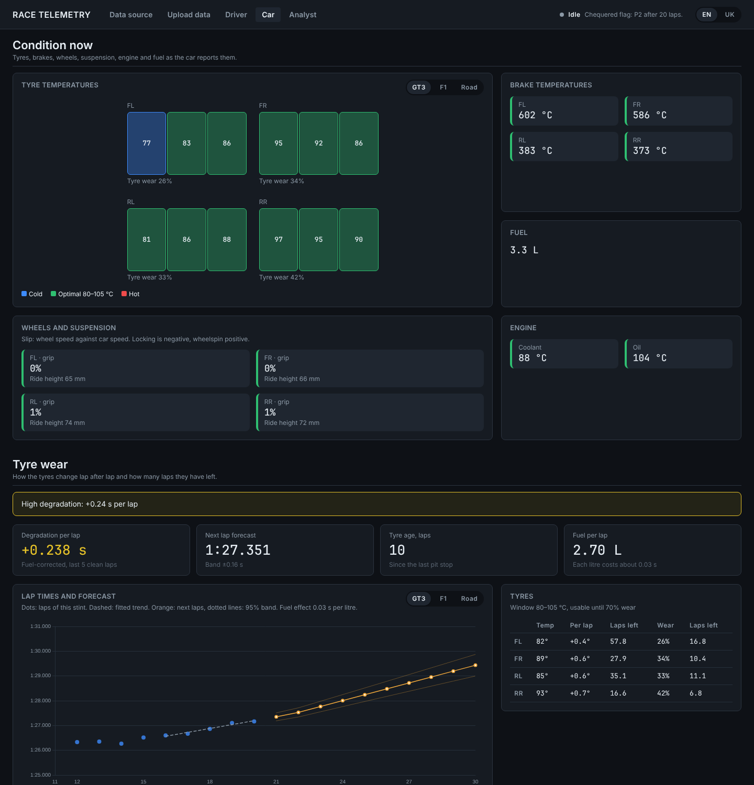

## Models

All of them live in `packages/ui/src/engines/racingMath/` as pure functions with unit tests.

**Tyre degradation: Kalman filter** (`kalmanTrendModel.ts`, `tyreDegradationModel.ts`). Each clean
lap's time minus the fuel it carried (`z = t − fuel · 0.03 s/L`) measures a two-number state: the
pace at the current tyre age and the time lost per lap of age.

```
x = [pace, rate]ᵀ      x_k = F·x_{k−1},   F = [[1, 1], [0, 1]]      z_k = pace_k + v,  v ~ N(0, R)
P_k = F·P·Fᵀ + Q       S = P₀₀ + R,   K = P·Hᵀ / S,   x += K·(z − pace),   P = (I − K·H)·P
```

- `R` (lap noise) comes from the laps themselves: the robust spread (MAD) of first differences
  (÷√2) and second differences (÷√6), whichever is smaller, so neither a slow lap nor a cliff inflates it.
- `Q` lets the pace drift 0.02 s and the rate 0.01 s per lap, which is what lets a cliff show up.
- A lap more than 3σ from the prediction (`ν² > 9·S`) is an outlier and skipped. Two in a row on
  the same side mean the car really changed: the second is accepted and `P` is scaled by `ν²/S`
  (fading memory) so the filter catches up.
- A Rauch–Tung–Striebel smoother draws the trend line through the stint; the forecast band is
  `±2·√(P₀₀ + R)` and grows with every lap ahead.

**Pit stop: Monte Carlo** (`strategySimulationModel.ts`). 1000 races are played for every stop lap
with the same random draws (common random numbers): pace and rate from `N(x, P)` of the filter, lap
noise `N(0, R)`, and a safety car that starts on a green lap with probability λ and lasts 2–4 laps.
Stopping after `k` laps with tyres `a` laps old, lap `j` costs `pace + rate·j` on the old set and
`pace + rate·(j − k − a)` plus the warm-up loss on the new one. The stop costs the pit loss, or half
of it under a safety car. The result per stop lap: expected loss against the best one, its 10–90%
range against the best in the same race, and the share of races it won. Without noise the optimum
is `k = (L − a) / 2` for `L` laps left, which the tests check.

**Undercut chance** (`pitWindowModel.ts`). The gain of stopping `n` laps earlier, `n·d·a − warm-up`,
is linear in the rate `d ~ N(μ, σ²)`, so `P = Φ((n·μ·a − warm-up − gap) / (n·a·σ))`.

**Understeer gradient: bicycle model** (`setupAdvisorModel.ts`). In a steady corner the steering is
`δ = L·κ + K·a_y`. With curvature `κ = a_y / v²` and the wheel angle known only up to the steering
ratio, every steady sample (no brake, |a_y| ≥ 0.15 G) goes into a least squares fit
`δ = c₁·κ + c₂_b·a_y`, with one `c₂` per speed band (under 110, 110–160, over 160 km/h). Then
`K = L·c₂/c₁` (° per G, `L` is the wheelbase of the car profile), characteristic speed
`v_ch = √(L·g/K)` for an understeering car and critical speed `v_cr = √(−L·g/K)` for an oversteering
one. Springs and bars act at every speed and wings grow with `v²`, so when `K` in fast corners is
0.5 °/G or more away from slow corners, the advice moves the aero balance instead of the bars.

## How laps are kept honest

- **Distance grid.** Every completed lap is resampled every 2 m of lap distance, so laps can be
  compared point by point. GT7 has no lap distance: the relay integrates speed, and each lap is
  stretched to the track length (at most ±5%) before resampling.
- **Lap quality.** A "lap" shorter than 20 s or 400 m, covering less than 90% of the track, or with an
  average speed above the top speed (a reset) is not a lap and is dropped. Laps cut by a return to the
  pits are invalid; laps that start in the pit lane are pit laps. Clean laps (valid, not pit, within 107%
  of the best) drive pace and consistency numbers.
- **Persistence.** Laps survive a page reload (IndexedDB, last 10 sessions). Learned track outlines
  are kept per game in `localStorage`, picked by track name or by the shape of the last 8 s of driving.

## Run it

Requires Node.js 20+.

```bash
npm install
npm run relay        # relay on http://localhost:8787 (WebSocket /ws)
npm start            # dashboard on http://localhost:5173
```

Open the dashboard, pick a source on **Data source** and press **Start**.

- **GT7:** enter the PlayStation IP (PS5: Settings → Network → Connection status). The relay must run
  on a computer in the same network. No console at hand? Run `npm run fake-gt7 -w @racing/relay` and
  use `127.0.0.1`; it emulates the console with encrypted packets.
- **F1:** choose season, race and driver. The first start downloads the data (one request at a time,
  OpenF1 is rate limited); later starts are offline. Pre-download from the command line:
  `npm run f1:fetch -w @racing/relay -- --year 2024`, then `-- --session <key> --driver <number>`.
- **Demo race:** pick the race length and speed on the **Demo race** card; at ×64 a 20-lap race is
  over in about 30 s and the session report is ready.
- **Raw data:** open **Upload data**, drop a CSV log, `session.json` + `frames.bin`, or a `.ndjson.gz`.
  The relay converts it into a recording in `data/sessions` (listed under **Uploaded before** and
  **Replay**). The relay also answers `GET /api/imports` with the list of uploads.
- Dashboard on another device (tablet next to the wheel): `VITE_RELAY_URL=http://<relay-ip>:8787 npm start`.

## Project layout

```
packages/
  shared/   telemetry and protocol typings shared by relay and UI
  relay/    sources (gt7, openf1, mock, replay, fileImport), lap tracker, recorder,
            HTTP (/api/imports, /api/recordings, /api/f1/*) + WebSocket server
  ui/       React 18 + TypeScript dashboard: pagesConfig, SCSS modules, react-query v3,
            react-router v5, ECharts 5, XML translations (en, uk)
docs/       project description (PDF) and screenshots
```

Key places:

- `relay/src/sources/*` — every source turns its data into `TTelemetryFrame` (`shared/src/telemetryTypings.ts`).
- `relay/src/sources/gt7/` — heartbeat, Salsa20 decryption, packet parsing, derived G and lap distance.
- `relay/src/sources/mock/` — the demo race: track and car physics (`mockTrack`), driver (`mockDriver`),
  tyres, brakes, fuel and suspension (`mockCar`), rivals (`mockField`), weather (`mockWeather`).
- `relay/src/sources/fileImport/` — uploads: CSV reader (`csvFile`), recorder files (`rtlgFile`), and
  `importedSession`, which turns any table of channels into laps, pit laps and frames.
- `ui/src/modules/telemetry/telemetryStore.ts` — frames go into a typed-array ring buffer; charts read
  it on their own timer, React subscribes only to throttled values.
- `ui/src/engines/racingMath/` — all the maths, as pure functions: delta, distance resampling, lap
  quality, ghost lap and corners, track map, tyre degradation (Kalman filter), pit window, pit stop
  simulation (Monte Carlo), weather, setup advisor,
  trail braking, lap detail and the session report.
- `ui/src/translations/{en,uk}.xml` — every UI string in both languages.

## Checks

```bash
npm run typecheck
npm run test:unit
npm run format
```

## Not verified yet

GT7 field offsets follow community reverse engineering and were tested with the fake console and
recorder files, not a live PS5 dump; setup advice thresholds may need tuning on real driving.
