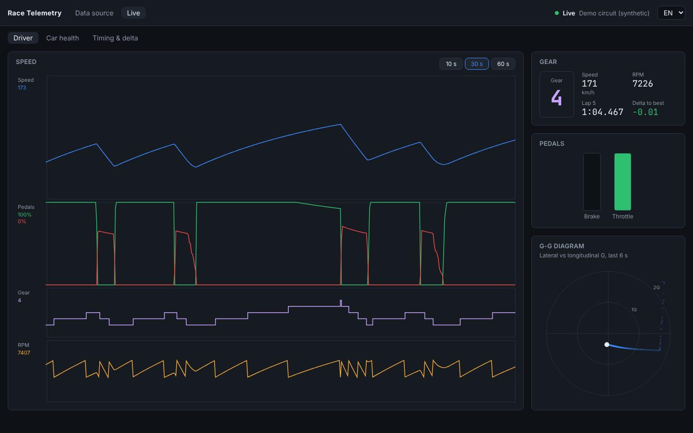

# Race Telemetry

Real-time sim-racing telemetry dashboard: a game or a real race feeds a small Node.js relay,
the relay normalizes everything into one frame format and streams it over WebSocket to a React
dashboard that charts 60 Hz telemetry with ECharts without re-rendering React at 60 Hz.

```
Gran Turismo 7 (PS5, UDP + Salsa20) ─┐
OpenF1 historical F1 races ──────────┤
Demo circuit (synthetic) ────────────┼──► relay (Node.js) ──WebSocket──► dashboard (React + ECharts)
Recorded sessions (replay) ──────────┘        │
                                              └── records every live session to data/sessions
```



## Modes

| Mode | Where the data comes from | What you get |
| --- | --- | --- |
| **Gran Turismo 7** | PS5/PS4 in the same LAN. The relay sends a heartbeat to UDP 33739 and decrypts the Salsa20 packets arriving on 33740 (~60 Hz). | Speed, RPM, gear, pedals, position, tyre temps (one per tyre), fuel, laps. G-forces and lap distance are derived. |
| **Formula 1, real races** | [OpenF1](https://openf1.org) historical API (free, no key). One driver's race is downloaded once, cached in `data/f1/cache`, and replayed as if live (×1–×8). | Speed, RPM, gear, throttle, brake on/off, position on track, laps with sectors, tyre compounds, the whole field with gaps. |
| **Demo circuit** | Built-in simulator on a fictional 3.8 km circuit with nine rivals. | Every channel, including tyre zones, brake temps and wear. Works anywhere. |
| **Replay** | Sessions the relay recorded from GT7 or the demo. | Whatever the original source had. |
| **Open a recorded file** | A session recorded from GT7 or Assetto Corsa by the telemetry recorder (`session.json` + `frames.bin`), or a relay recording (`.ndjson.gz`) from another computer. | Every channel in the file: laps with sectors, track map, ghost lap. Plays up to ×64. |

Each source announces its capabilities, so panels a source cannot fill are hidden or simplified.
Assetto Corsa / ACC are not supported: on PS5 they expose no telemetry (on PC they use Windows
shared memory, which could be added later as another source).

## Run it

Requires Node.js 20+.

```bash
npm install
npm run relay        # relay on http://localhost:8787 (WebSocket /ws)
npm start            # dashboard on http://localhost:5173
```

Open the dashboard, pick a mode on **Data source** and press **Start**.

- **GT7:** enter the PlayStation IP (PS5: Settings → Network → Connection status). The relay must run
  on a computer in the same network. No console at hand? Run `npm run fake-gt7 -w @racing/relay` and use
  `127.0.0.1`; it emulates the console with encrypted packets.
- **F1:** choose season, race and driver. The first start downloads the data (one request at a time,
  OpenF1 is rate limited); later starts are offline. Pre-download from the command line:
  `npm run f1:fetch -w @racing/relay -- --year 2024`, then `-- --session <key> --driver <number>`.
- **Recorded file:** on the **Open a recorded file** card pick `session.json` and `frames.bin` together
  (or one `.ndjson.gz`). The relay converts it into a recording in `data/sessions`, so it also appears
  under **Replay** later. Laps cut by a reset to the pits are kept but marked invalid; laps that start
  in the pit lane are marked as pit laps.
- Dashboard on another device (tablet next to the wheel): `VITE_RELAY_URL=http://<relay-ip>:8787 npm start`.

## Project layout

```
packages/
  shared/   telemetry and protocol typings shared by relay and UI
  relay/    sources (gt7, openf1, mock, replay), lap tracker, recorder, HTTP + WebSocket server
  ui/       React 18 + TypeScript dashboard (griddly-ui conventions: pagesConfig, SCSS modules,
            react-query v3, react-router v5, feature folders with *Functions / *Queries / *Typings)
```

Key ideas:
- `relay/src/sources/*` — every source turns its data into `TTelemetryFrame` (`shared/src/telemetryTypings.ts`).
- `ui/src/modules/telemetry/telemetryStore.ts` — frames go into a typed-array ring buffer; ECharts charts read it
  at 15 Hz (`modules/chart/TraceChart.tsx`, `GGDiagram.tsx`), React subscribes only to throttled values.
- `ui/src/engines/racingMath/deltaModel.ts` — live delta to the best lap, interpolated by distance.

## Checks

```bash
npm run typecheck
npm run test:unit
npm run format
```

## Roadmap

See the implementation plan: ghost lap overlay by distance, track map heat map, tyre degradation model,
pit window / undercut optimizer, static demo build for GitHub Pages.
